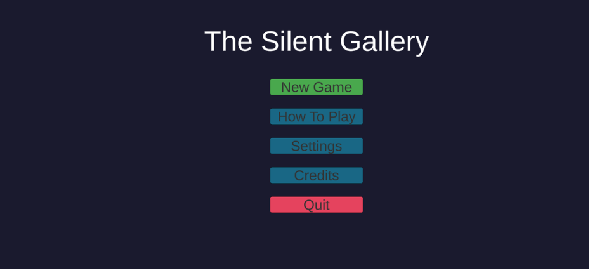
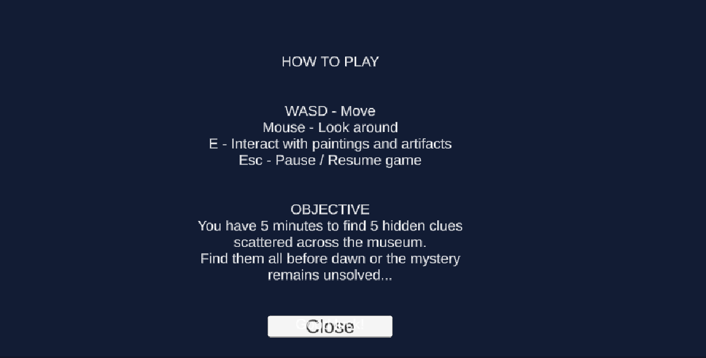
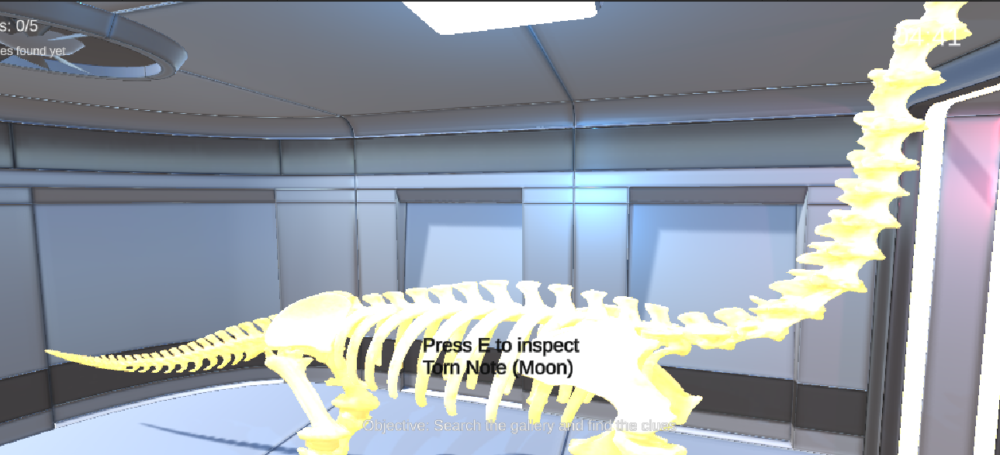
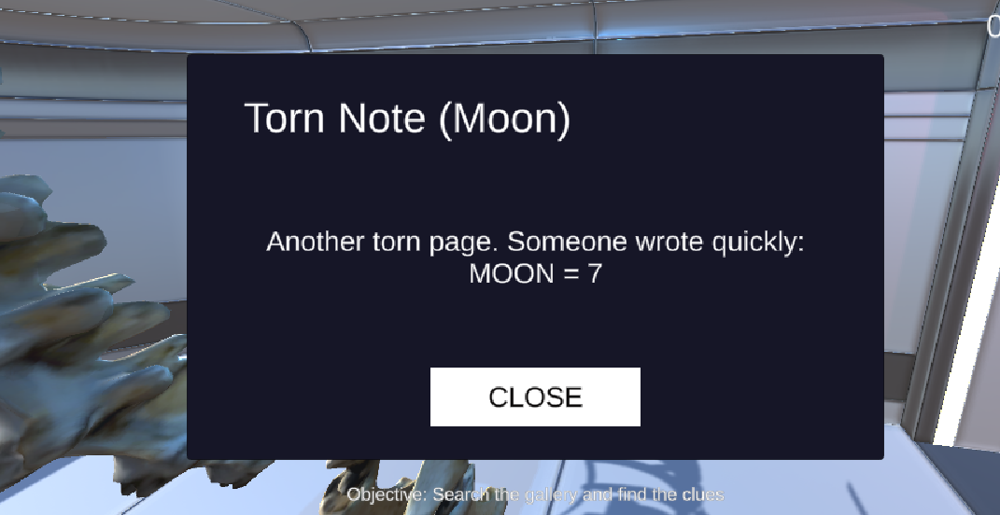
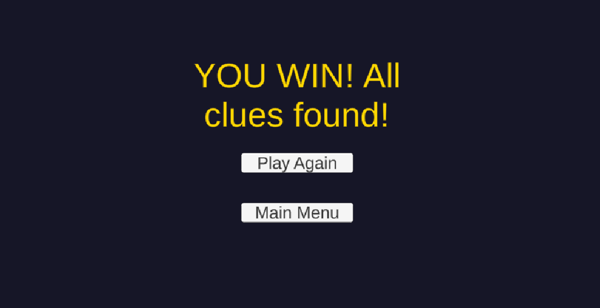
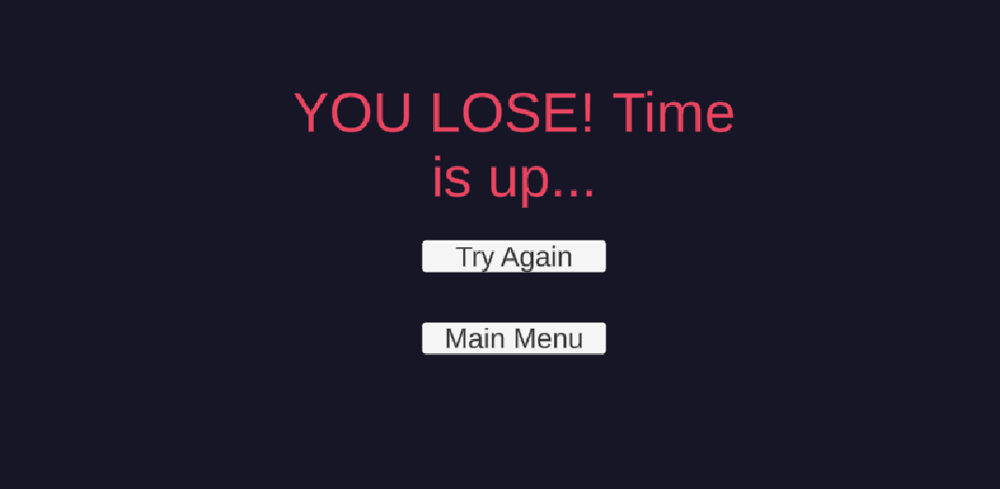

Welcome. This document provides essential information about the game, including how to play, game mechanics, controls, and additional notes.

## Team Group H

**Game Name:** The Silent Gallery

**Participants:**
- Fatima Abu Abed
- Marwa Hoshia
- Hiba Abdo
- Haneen Shqerat

## Table of Contents

- [Game Overview](#game-overview)
- [Credits](#credits)
- [How to Play](#how-to-play)
- [Controls](#controls)
- [Objectives & Goals](#objectives--goals)
- [Game Mechanics & Features](#game-mechanics--features)
- [System Requirements](#system-requirements)
- [Known Issues & Troubleshooting](#known-issues--troubleshooting)
- [Additional Notes](#additional-notes)
- [Media](#media)

## Game Overview

**Genre:** First-person mystery / exploration

**Platform:** Windows

**Team:** Fatima Abu Abed, Marwa Hoshia, Hiba Abdo, Haneen Shqerat

The player is locked inside a museum gallery after closing time, following the theft of a valuable artifact. Eight clues are hidden among the exhibits, but only five are needed to reach a verdict. One additional clue sits behind a locked cabinet, guarded by a 3-digit combination you can piece together from clues found elsewhere in the gallery. Once enough evidence is gathered, you're asked to name the culprit — get it right before the clock runs out to win, or the mystery goes unsolved.

## Credits

### Individual Contributions — Marwa Hoshia

- Built the core UI flow: the How To Play panel, the Settings panel (master/music volume, mouse sensitivity), and the loading screen between the Main Menu and the Gallery
- Designed `UIState`, a central cursor-lock/pause-blocking system used by every panel in the game (pause menu, settings, clue popups, combination lock, conclusion quiz, cheat panel) so they don't fight over cursor control or stack on top of each other
- Built the conclusion/accusation system: a final quiz the player must answer correctly to win, replacing the earlier "win on last clue found" logic
- Fixed a number of interaction and UI bugs: missing colliders on several clue objects, a clue object left disabled in the scene, the interaction prompt rendering through open panels, the pause menu opening on top of other panels, and a quiz panel where every element was stacked on the same position
- Gave the combination lock puzzle real stakes: solving it now grants bonus time, and its reward clue was rewritten to actually point to the culprit instead of being flavor text
- Set up Git LFS for the submission repository and merged the team's separate work (audio, HUD, puzzles) into a consistent history across both repositories

Third-party environment and prop assets used, under their respective licenses, for educational, non-commercial coursework use:

- 3D Free Modular Kit — Barking_Dog
- Greek Statue
- Oil Paintings — PolyKebap
- Bust of Sappho, Owl Statue — AK Studio Art
- Ancient Pots
- Books pack
- Free Statue Pack
- Concrete Bench — H&L Assets
- Furniture (Bandaji, folding screens, tables) — KCDF

## How to Play

**Starting the Game:** Open the project in Unity 2022.3.62f3, open `Assets/MainMenu.unity`, and press Play — or run a built `.exe`, which starts at the Main Menu automatically. From the Main Menu, select **New Game** to begin.

**Gameplay Basics:** You start inside the gallery with a 5-minute countdown already running (shown top-right of the screen). Walk around, look at the exhibits, and press **E** whenever a "Press E to inspect..." prompt appears to reveal a clue or open an interactable object, such as the combination lock. Each clue opens a popup with its title and text, then closes automatically, or via the on-screen Close button; press **J** at any time to review everything you've found so far in the evidence journal. Once you've revealed 5 clues, a final accusation screen appears — pick who you believe is responsible.

**Levels/Stages:** The game has a single gameplay scene (the Gallery). There are no separate levels — the whole objective is contained within one continuous playthrough.

## Controls

| Action | Input |
|---|---|
| Move | `W` `A` `S` `D` |
| Look around | Mouse |
| Interact with paintings and artifacts | `E` |
| Open evidence journal | `J` |
| Pause / Resume | `Esc` |

## Objectives & Goals

**Main Objective:** Reveal 5 of the 8 hidden clues scattered across the museum, then correctly accuse the culprit in the final quiz — all before the 5-minute timer runs out.

**Secondary Goals:** A locked cabinet can be opened by solving a 3-digit combination hinted at across three of the clues; solving it reveals an extra clue and grants bonus time on the countdown. A limited number of hints are available if you get stuck on the combination, at the cost of time.

## Game Mechanics & Features

- **Clue Reveal System:** Interactable exhibits hold clue data (title + text). Eight clues exist in total; finding any 5 of them is enough to trigger the final accusation. Already-found clues can be re-inspected without double-counting, and the evidence journal (`J`) lists everything revealed so far.
- **Combination Lock Puzzle:** A locked cabinet guarded by a 3-digit code, pieced together from three of the clues. Solving it grants bonus time on the countdown and unlocks one additional clue; a built-in hint system can reveal digits at the cost of time if you're stuck.
- **Conclusion / Accusation System:** Once 5 clues are found, a final quiz asks you to name the culprit from a short list of suspects. Answering correctly wins the game and stops the clock; a wrong answer costs you an attempt and a short time penalty before you can try again, with a limited number of attempts before you lose outright.
- **Interaction System:** A camera raycast detects nearby interactable objects and shows a context-sensitive prompt before you interact; this pauses automatically whenever a menu or panel is open.
- **Countdown Timer:** A 5-minute timer runs from the moment gameplay starts, shown top-right of the screen, and drives the lose condition if it reaches zero — including while the final quiz or the combination lock is open.
- **Win / Lose End Screen:** Correctly naming the culprit in time shows "YOU WIN!"; running out of time or out of quiz attempts shows "YOU LOSE!". Both offer a restart button and a return to Main Menu.
- **Pause Menu:** `Esc` opens a pause overlay (Resume / Restart / Main Menu / Quit) and freezes gameplay time without exiting the scene; it won't open on top of another panel that's already up.

## System Requirements

**Minimum Requirements:**
- OS: Windows 10 or later
- Processor: Any dual-core CPU from the last decade
- Memory: 4 GB RAM
- Graphics: Any GPU with DX11 support (integrated graphics is sufficient)
- Storage: ~1 GB free space

**Recommended Requirements:**
- OS: Windows 10/11
- Processor: Quad-core CPU
- Memory: 8 GB RAM
- Graphics: Dedicated GPU
- Storage: ~1 GB free space

## Known Issues & Troubleshooting

- **Main Menu doesn't appear when pressing Play in the Unity Editor:** Play mode runs whichever scene is currently open in the Editor, not necessarily the first Build Settings scene. Open `Assets/MainMenu.unity` before pressing Play. This does not affect built `.exe` versions, which always start at the Main Menu correctly.

## Additional Notes

**Game Version:** Submission build, August 2026

**Last Update:** See the repository's commit history for the most recent changes.

**Contact Information:** Reach out to any team member listed above via the course's usual channels for bug reports or feedback.

## Media

**Gameplay video:** [Watch on YouTube](https://youtu.be/twJdEOO1994)

**Screenshots:**

| Main Menu | How to Play |
|---|---|
|  |  |

| Gameplay | Clue Popup |
|---|---|
|  |  |

| Pause Menu | Win Screen | Lose Screen |
|---|---|---|
|  |  |  |
